# Day history: swipe back and edit entries (MVP-07)

Task: [TachoBook — Day History: Swipe Back and Edit Entries](https://app.notion.com/p/3f9db41bd74b81d8bed7df41cd177284)
Executor: Claude Code. Branch: `claude/day-history-edit`. Base: `6dec1ffe63ef261eb1757b0066356ca36db7f7c7` (origin/main, after the Home flow merge).
Figma: [09 Home — rest, Work tab, node 490:26329](https://www.figma.com/design/rpZZnwAC53fG7zjQy42Snq/TachoBook--UI-Design?node-id=490-26329) is the past-day layout. Figma values are sample content.

## What the driver gets

- Swipe right on Home (finger moves right, as in iOS Calendar): the previous day, up to 3 days back (`DayHistory.maxDaysBack`). Swipe left: toward today. A swipe further back on the oldest day shows a small label "Older days are in History." near the strip (it leaves after 3 s or on any tap, and returns with the next such swipe; no navigation). Today is the newest day; at day −3 and at today the swipe does nothing.
- The date strip is fixed: `DayHistory.maxDaysBack` days before today, today, and the days after today that fill the five slots (3 back, today, tomorrow). Swiping or tapping moves only the selection circle; the dates never scroll, and the strip updates at midnight. Figma centres the selected day; this is an approved difference.
- Dates in the header strip that the swipe can reach (today and 3 days back) are buttons and open that day. Other dates (deeper, or in the future) do nothing and look the same. Tap targets are 44 pt; VoiceOver reads the full date.
- A **Today** button next to the settings icon whenever a past day is shown. Hidden on today.
- A past day uses the Home layout. Work tab: frozen work card and the day summary. Rest tab: the rest taken after that shift, as HH:MM.
- An empty day shows "?" in Day started, Driving and Day closed and "--:--" in the cards. Browsing writes nothing.
- A past day with no shift that one rest covers whole (it started on an earlier day and ended on a later day or is still running) shows one line in the summary card: "No shift this day — you were resting since Sat 17, 23:52." A tap opens the day the rest started if the swipe can reach it; otherwise it is plain text. Interim copy; the Figma design for this state is a separate task.
- Tapping a field opens the same sheet as on Home (Shift start, Rest start, Driving time) for the selected date. Saving creates or updates that day's record. Invalid values keep Confirm disabled, and every time sheet (Home and past days) says why in one line under the picker.
- VoiceOver: the selected day in the date strip is adjustable (swipe up/down moves a day).

## Rules as built

| Topic | Behaviour |
|---|---|
| Day | The calendar date of the shift start (device calendar). A shift across midnight stays on its start date; the next day shows empty. |
| Records | A record may hold only some fields. Past records are stored with the archived periods, so there is no schema change and existing data is untouched. |
| Active shift | Never changed by browsing or by past entries. An open (running) shift is shown only on today. A closed shift whose rest is still running is the latest closed shift: it shows on its start day and is edited with the existing Home commands. |
| Animations | Standard SwiftUI animations (`withAnimation`, system transitions): Work/Rest switch (native segmented `Picker`), day change (push; cross-fade with Reduce Motion), the selection circle (`matchedGeometryEffect`; fades in place with Reduce Motion), Today button, the rest note, the history hint and the reason line. Sheets keep the system presentation. |
| Reasons under a disabled Confirm | Future: "This time hasn't happened yet." Day closed before Day started: "Day closed can’t be before Day started (Fri 16, 06:10)." Overlap: "This overlaps your shift from Wed 14, 20:10 to Sun 18, 20:01." (open shift: "…your current shift from Wed 14, 20:10.") Time outside the day: "Pick a time on Sat 17." Dates and times follow the device locale. The validators return the reason (`TimeEntryIssue`); a disabled case without approved copy (Start of day before the rest milestone, a rest-link edge) shows nothing. |
| Validation (R-E01) | Start on the selected day and not in the future. End not before start, not in the future. No overlap with another record or the running shift (touching at one instant is allowed). Driving not negative. Start of day on Home cannot precede the end of an entered past shift. |
| Rest taken | Next shift start minus this shift end. If there is no later shift: time up to now, labelled "So far", end "Running". No Day closed: placeholder. Not classified as daily or weekly; no 9/11/24/45 h markers. |
| Default time in sheets | The current time of day on the selected date (an existing value when editing). |
| Recompute | Rest taken, durations and limits are derived on every render from the stored timestamps, so editing a day updates its neighbours. |

## Screenshots (Debug, simulator)

Day −1 of the seeded scenario (`-homeFlowUITest -seedReadyWeeklyRest`, yesterday is always empty). The filled day was entered through the UI with the default time of day, so start and close are the same minute. Figma references: [frame 09](../home-flow/figma-09.jpg), [driving sheet](../home-flow/figma-07.jpg), [rest start sheet](../home-flow/figma-05.jpg). Figma has no Today button and no completed-rest state.

| State | Figma | 402 pt | 390 pt |
|---|---|---|---|
| Empty day, Work tab | 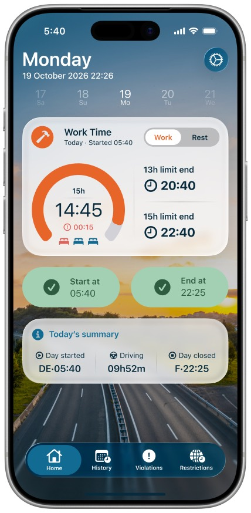 | 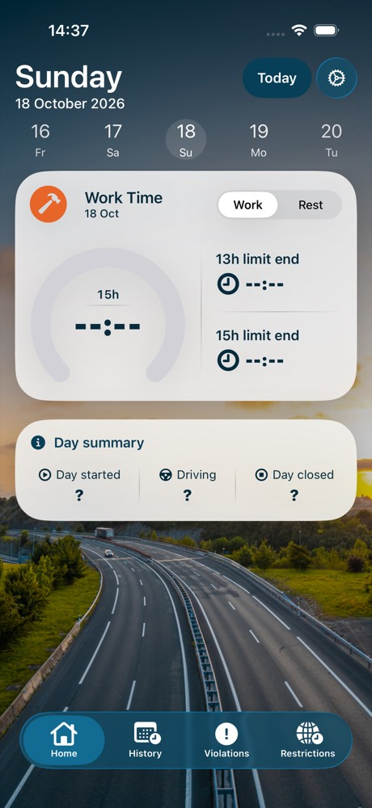 | 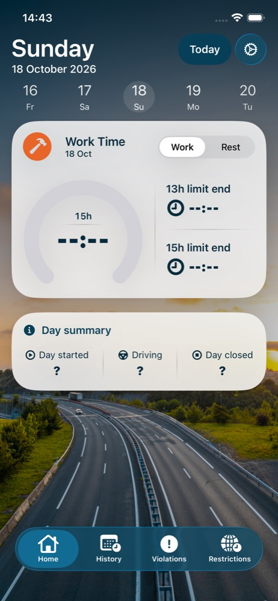 |
| Filled day, Work tab |  | 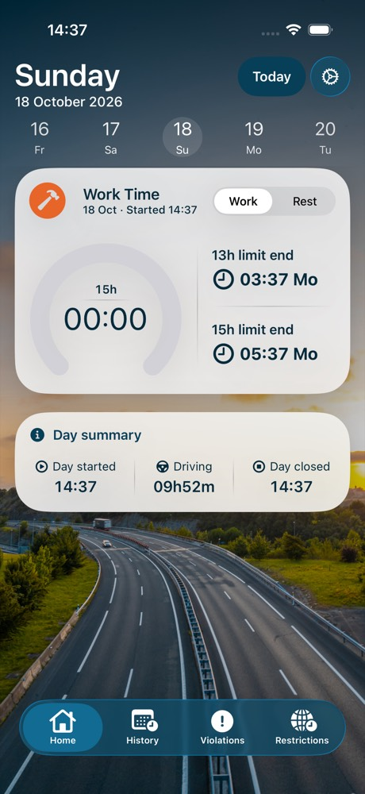 | 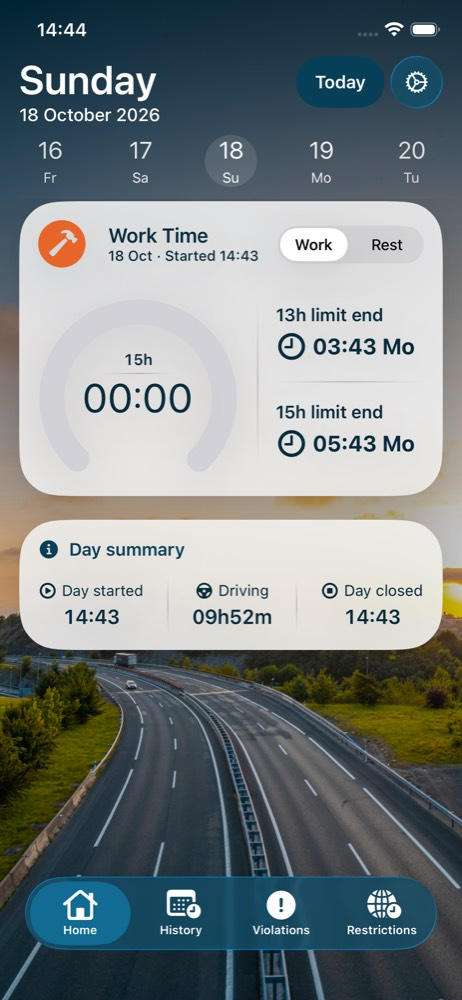 |
| Rest tab (rest taken) |  | 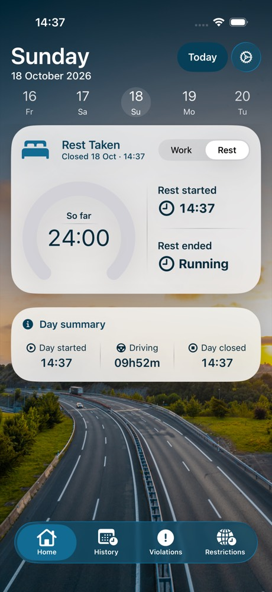 | 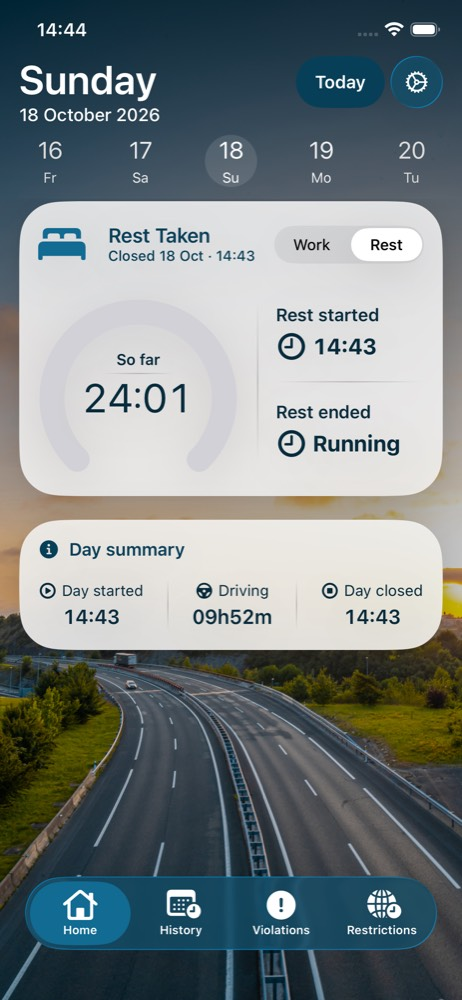 |
| Edit sheet (Driving, prefilled) | 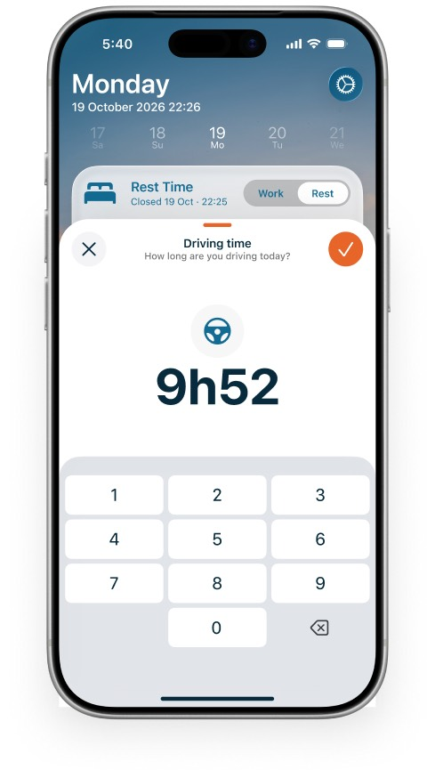 | 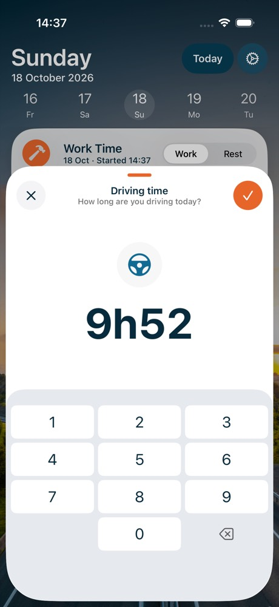 | 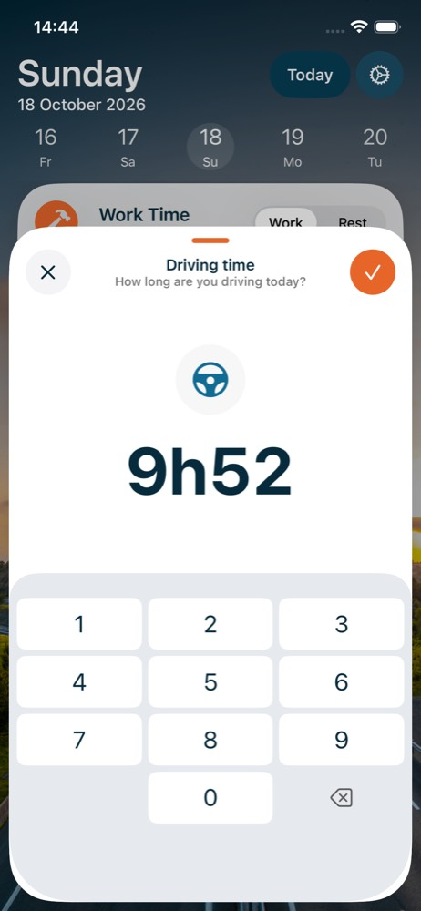 |
| Day −3, the limit | — | 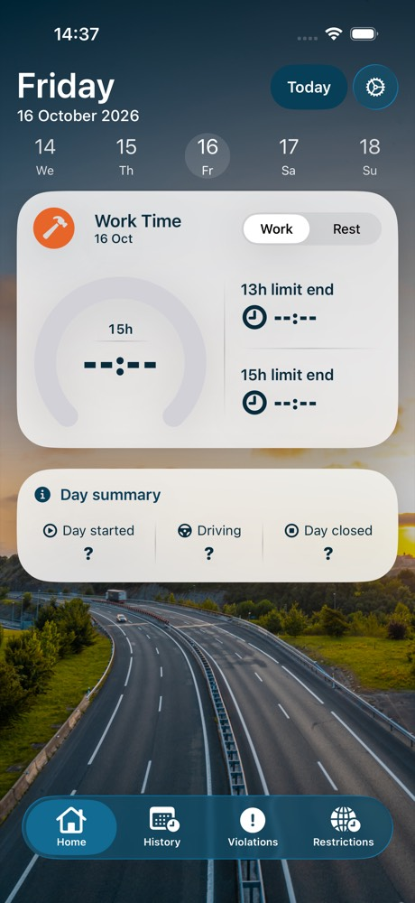 | 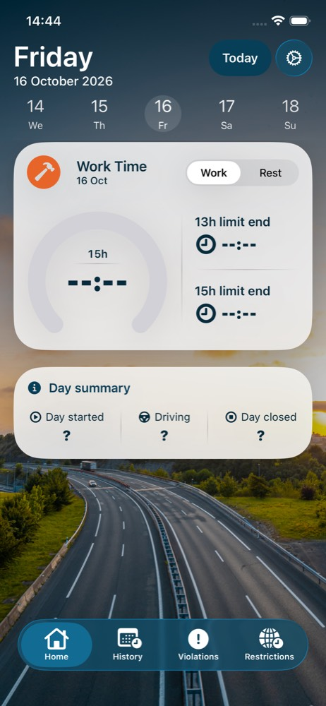 |
| Date strip with the selected day (Sat 17) | — | 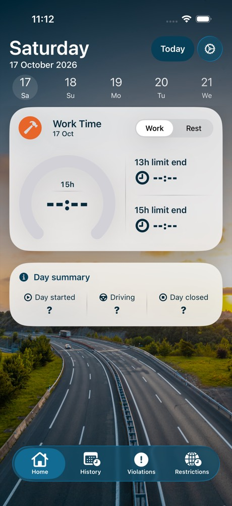 | 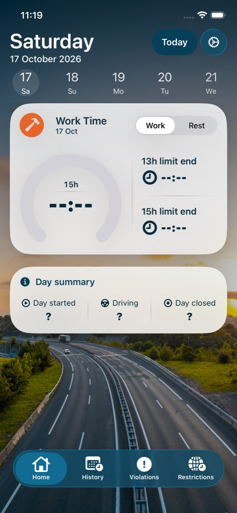 |
| Note on a day covered by rest | — | 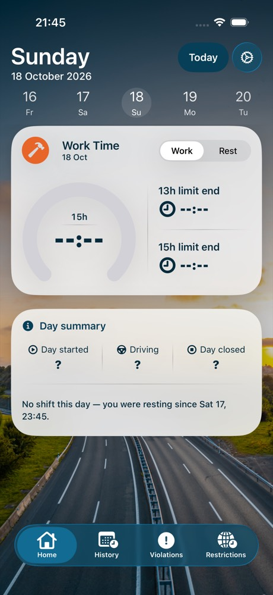 | 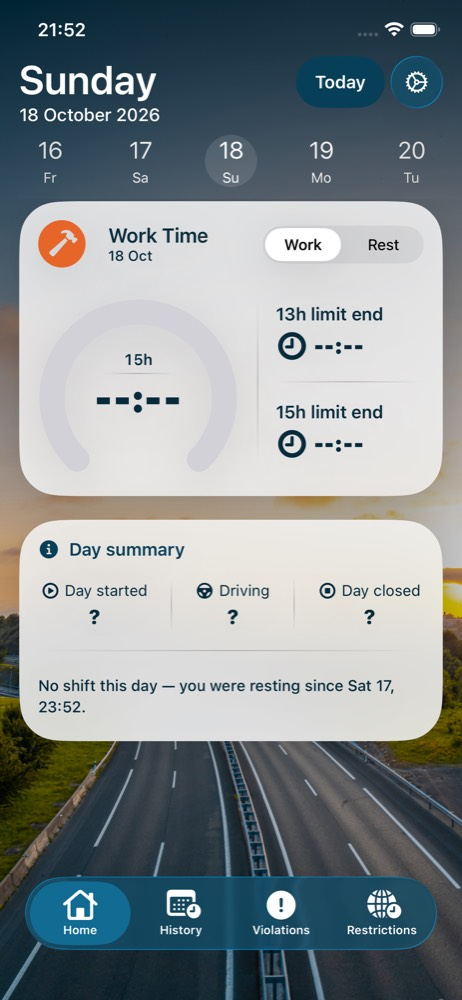 |
| Hint at the history limit | — | 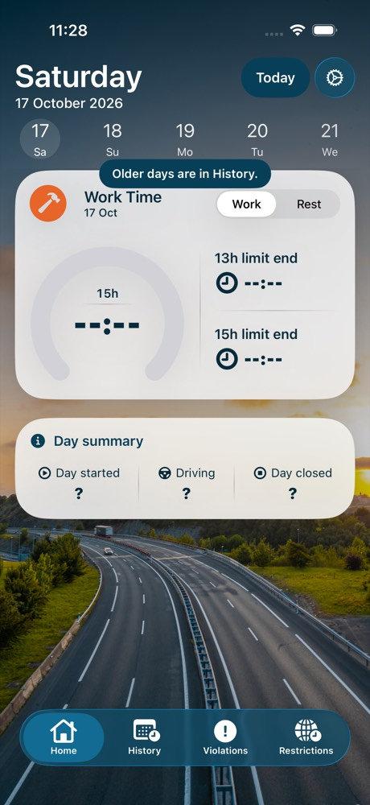 | 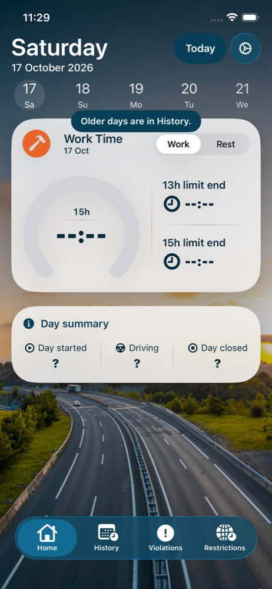 |
| Reason under the picker (stored shift covers yesterday) | — | 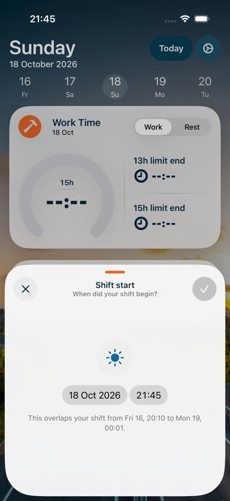 | 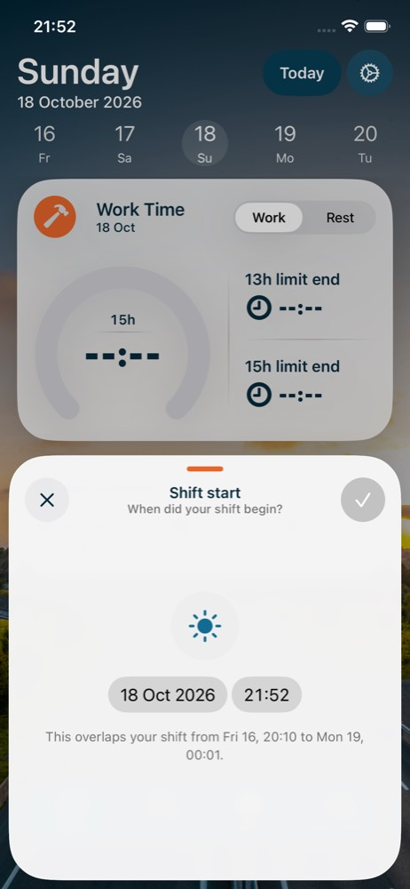 |

## Tab bar (F7): paused, decision needed

Figma node 490:26372 shows four tabs (Home selected, History, Violations, Restrictions dimmed). A native SwiftUI `TabView` with `Tab(...).disabled(true)` shows them dimmed and inert ([prototype](tabbar-native-prototype-402.jpg), [Figma](tabbar-figma.jpg)), but SwiftUI does not give the disabled tabs the accessibility "not enabled" trait: VoiceOver does not say "dimmed", and the accessibility audit reports "Missing trait: UIAccessibilityTraitNotEnabled" for History, Violations and Restrictions in every Home state. Setting `isEnabled`, `accessibilityTraits` on `tabBar.items` and on the tab buttons through UIKit had no effect on what XCUITest and the audit see. The current custom tab bar stays in this PR until the choice is made.

## Known differences and limits

- The Today button is not in Figma. It is a solid dark capsule (`#083F58`) next to the settings icon; translucent glass over the sky failed the contrast audit.
- Figma has no completed-rest state; the Rest card layout is reused with "Rest Taken", "Rest started", "Rest ended".
- Widget "--:--" and "?" placeholders use a heavier font weight so the audit can read them.
- Swipes are ignored while a sheet or alert is open. A horizontal swipe is also never treated as a tap on a button underneath it (found by the UI test: a swipe across the Start of day capsule opened its sheet).
- The accessibility audit passes in every past-day state at 402 pt (the note text needed a medium font weight). At 390 pt it flags the empty day (and, in some runs, other states) with "Contrast failed" on text whose measured contrast from the screenshot is about 11:1; which elements are flagged changes between runs of the same build. Home states pass at 390 pt. Serhii accepted this as a tool flake on 2026-10-19.

## Run it

```sh
xcrun simctl launch --terminate-running-process booted com.grifano.TachoBook -homeFlowUITest -seedReadyWeeklyRest -resetHomeFlowTest -startDaysBack 1
```

`-startDaysBack N` (Debug only) opens day −N directly. `-seedLongShift` (Debug, with `-homeFlowUITest`) stores a shift from three days ago 20:10 to just after midnight today; yesterday's default start then overlaps it and the sheet shows the reason.
