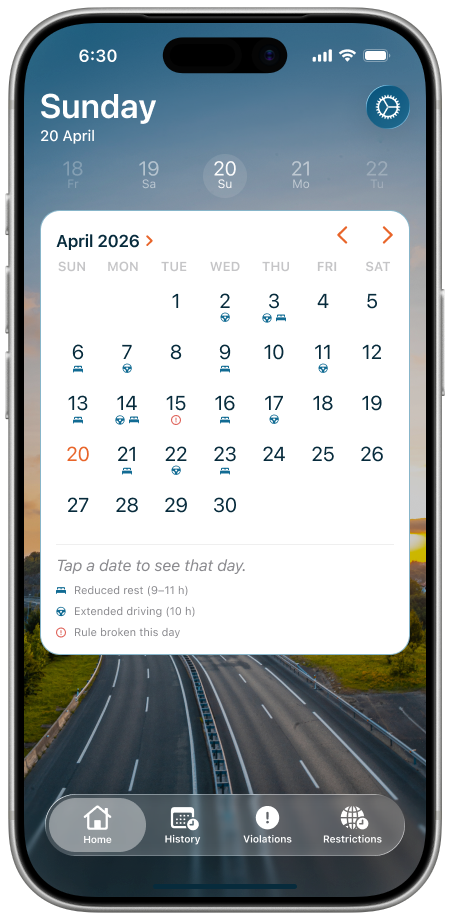
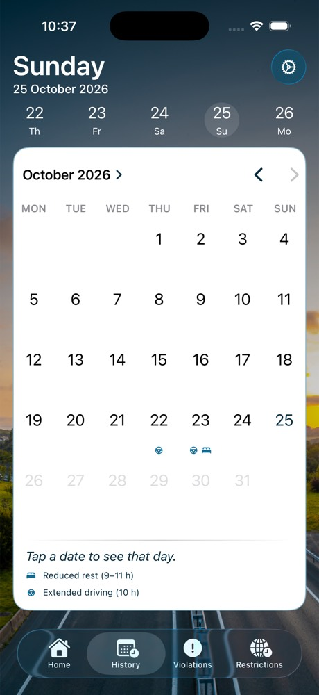
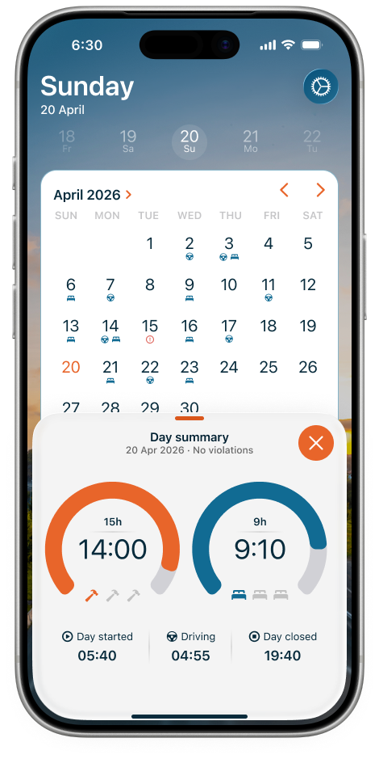
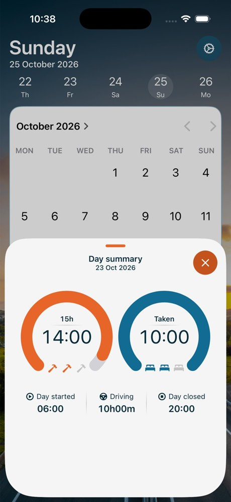
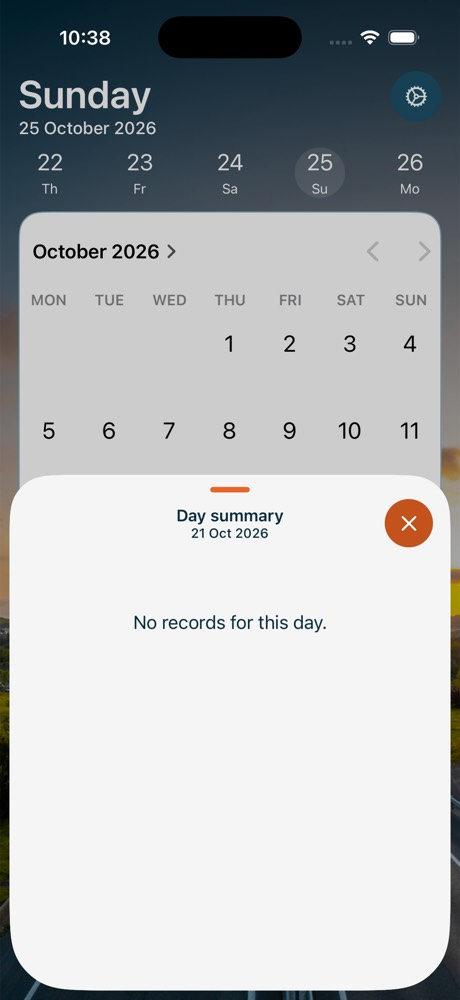

# History: month calendar and Day summary sheet

Task: [TachoBook — History: Month Calendar + Day Summary Sheet](https://app.notion.com/p/403db41bd74b81dd8ef4e4a4087dcbab).
Figma: frame 01 `708:31832` (calendar), frame 02 `708:31844` (Day summary sheet, medium detent), legend `707:30740`.
Frame 03 `708:31874` (violations) is out of scope.

## Behaviour

- History tab is active (Violations and Restrictions stay inert). Home and History share one `DayLogModel`.
- Native `UICalendarView` (`HistoryCalendar`, `UIViewRepresentable`): current month, month arrows, future dates
  outside `availableDateRange` (dimmed, not selectable). A tap opens the sheet; the selection is cleared at once,
  so the same date can be tapped again.
- Markers (`HistoryMarkers.swift`), derived from stored records on every read:
  - **Bed** (`bed.double.fill`): the day the Home row of PR #13 gains a reduction — `reductionIDs(endOf:)` of
    the day contains a reduction that the previous day's set does not. That is the day the reduced rest ended,
    or the shift day once its duty passes 13 h. Unknown count (no completed weekly rest) → no bed.
  - **Wheel** (`steeringwheel`): the day's shift has driving over 9 h and up to 10 h. Over 10 h is a violation
    (later task) and gets no marker yet.
  - A shift across midnight belongs to its start date (`DayHistory.recordDay`).
  - VoiceOver: the date cell reads "Friday, October 23" with the value "reduced rest, extended driving".
- Legend (interim copy, decision 6): hint "Tap a date to see that day.", bed + "Reduced rest (9–11 h)",
  wheel + "Extended driving (10 h)". No "Rule broken this day" line.
- Day summary sheet (`DaySummarySheet.swift`), read-only, medium and large detents: title "Day summary",
  subtitle "23 Oct 2026", Work gauge (duration vs 15 h, hammers), Rest gauge (rest taken, beds), Day started /
  Driving / Day closed. Values come from the same helpers as Home's past-day cards. A day without a record
  shows "No records for this day."

## Screenshots (iPhone 17 Pro, 402 pt)

| Figma 01 | App | Figma 02 | App, data | App, empty day |
|---|---|---|---|---|
|  |  |  |  |  |

390 pt: `calendar-390.jpg`, `sheet-data-390.jpg`.

## Known gaps against Figma

- Native calendar look: rows are taller (UIKit reserves space for decorations), weekday headers are system
  gray, day numbers are system black, and the week starts on the device's first weekday.
- Today is navy (tint), not orange: F9 allows only navy text on light surfaces.
- At the largest text sizes the system calendar grows its day numbers only part of the way; the UI-test audit
  ignores exactly that issue for day-number labels (`isNativeCalendarDayNumber`).
- iOS 26 draws the medium-detent sheet slightly scaled down; the sheet audit runs on the expanded sheet.
