# Always-on beds & hammers row (+ history)

Task: [TachoBook — Always-On Beds & Hammers Row (+ History)](https://app.notion.com/p/402db41bd74b811e9597c4e40b7cadca)
Executor: Claude Code. Branch: `claude/always-on-beds-hammers`. Base: `467805da3a23109ccaf48f7cecdb9a35e262a084` (origin/main).
Figma: [Weekly Rest card with beds, 490:26367](https://www.figma.com/design/rpZZnwAC53fG7zjQy42Snq/TachoBook--UI-Design?node-id=490-26367) and [Work view with hammers, 564:39337](https://www.figma.com/design/rpZZnwAC53fG7zjQy42Snq/TachoBook--UI-Design?node-id=564-39337) (confirmed by Serhii on 24.10.2026). Figma values are sample content.

## What the driver gets

- The row under the gauge is always there on the Home main widget: three beds on the Rest view, three hammers on the Work view. A bed is one reduced daily rest (9 h); a hammer is one extended duty period (up to 15 h). One reduction = one red bed = one red hammer, so both views always show the same number of red icons.
- While the count is unknown (no completed weekly rest in the records) all icons are blue. Internally the count and the 15 h availability stay unknown (R-U01, P2).
- Earlier days in the date strip show the row as it stood at the end of that day: only the records of that day and earlier count. A history edit recomputes every day after it (R-E01).
- VoiceOver: "1 of 3 reduced rests used" / "1 of 3 extended shifts used"; "Reduced rests used: unknown" / "Extended shifts used: unknown"; "4 … used, limit 3" after a fourth reduction.

## Why the beds disappeared (owner report, 23.10.2026)

Read from the owner's device store (iPhone 12, `shifts-v1.store`, copied read-only on 24.10.2026). The records were fine and the count was known all the time: weekly rest 20.10 12:31 → 21.10 12:51 (24 h 20), then reduced rests ending 22.10 (9 h 08) and 24.10 (9 h 12). The row was hidden by the screen, not lost by the counter:

1. Today's Work card took its row from the pending-reduction value (`workCardReducedRests`, decision 13 of PR #11), which is nil for the first 13 h of every shift. During a shift the Rest view is disabled, so from the start of each shift until 13 h nothing showed the beds at all — on 23.10 from 06:28 until 19:28.
2. The past-day widgets (Work and Rest Taken) never received a count, so no earlier day ever showed the row.
3. An unknown count also hid the row (decision 11 of PR #11).

Fix: Home uses one value for both views (`homeReducedRests(now:)`: completed count plus the pending reduction) and the row is never hidden; past days use `reducedRests(endOf:now:)`. Regression tests: `HomeCountRowTests.theRowShowsTheKnownCountDuringTheFirstThirteenHoursOfAShift` and `aPastDayShowsTheCountItHadAtTheEndOfThatDay` replay the owner's week; both failed against the old wiring and pass now. UI: `RestCountUITests.testWorkCardShowsHammersBeforeAndAfterThirteenHours` (12:59 of duty now shows the row).

## Rules as built

| Topic | Behaviour |
|---|---|
| Counting | Unchanged from PR #11 (see [rest-counter](../rest-counter/README.md)): the completed count since the last rest ≥ 24 h, plus the pending reduction of a shift past 13 h without a confirmed split. |
| Today | Rest and Work views both show `homeReducedRests(now:)` (the former Rest card value). |
| Past day | `reducedRests(endOf:now:)`: records whose day (Day started, else the record's date) is that day or earlier, judged at 23:59:59 of that day — what Home showed at the end of that day. A rest that ends the next morning is not yet counted; a shift past 13 h already shows its reduction on its own day. |
| Unknown | All three icons blue; `reducedRestsUsed` and `dutyLimitAvailability` stay unknown. |
| Edits | Derived on every read, so history edits and relaunches recompute today and every past day. |

Example from the owner's week: 21.10 → 0 (the 9 h 08 rest is still running at midnight), 22.10 → 1, 23.10 → 2 (13 h 59 shift), 24.10 → 3 (13 h 38 shift, resting).

## Screenshots

Simulator iPhone 17 Pro (402 pt) and "TachoBook Home 390" (390 pt), iOS 26.5, from `RestCountUITests`. Figma: Rest 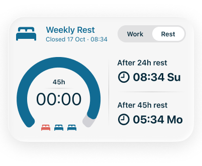 Work 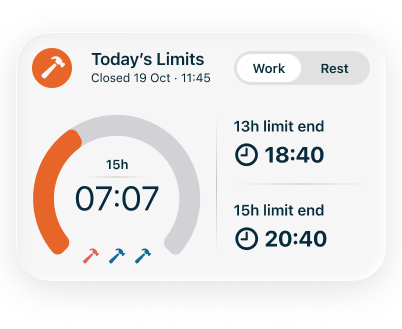

| State | 402 pt | 390 pt |
|---|---|---|
| Today, Rest (weekly card), 1 used | 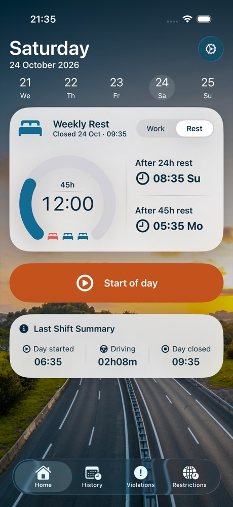 | 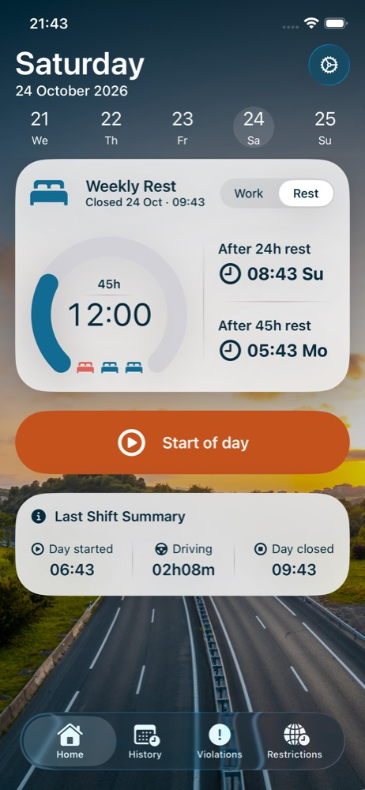 |
| Today, Work at 12:59 of duty, 1 used (was hidden) | 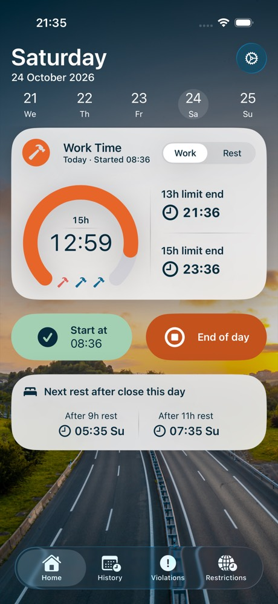 | 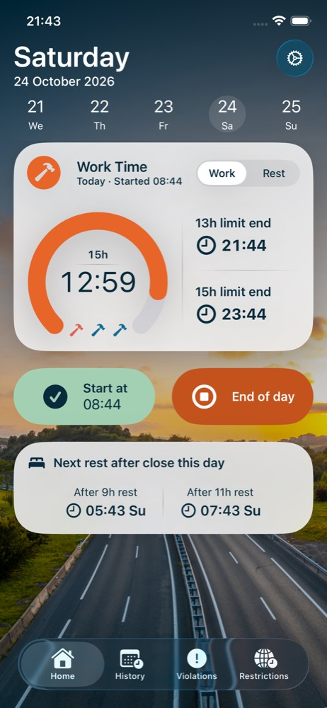 |
| Today, Work at 13:30, pending reduction (2) | 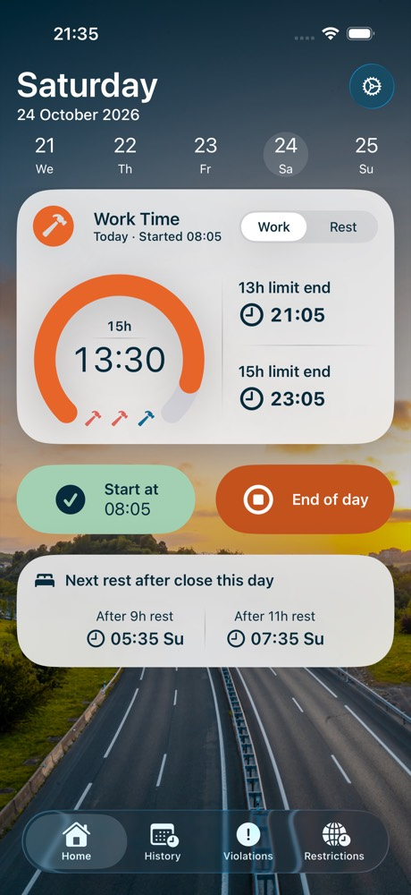 | 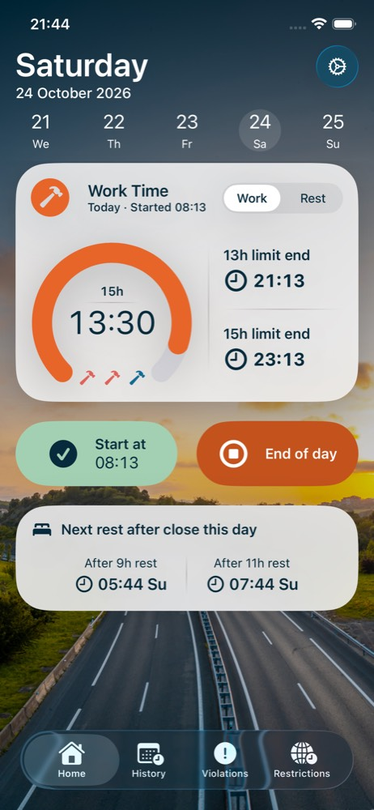 |
| Past day (2 days ago), Work, 2 used | 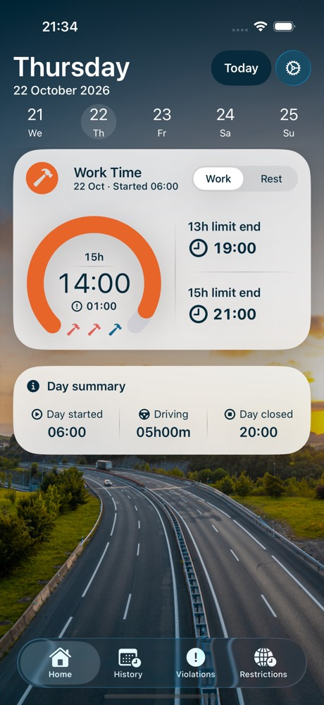 | 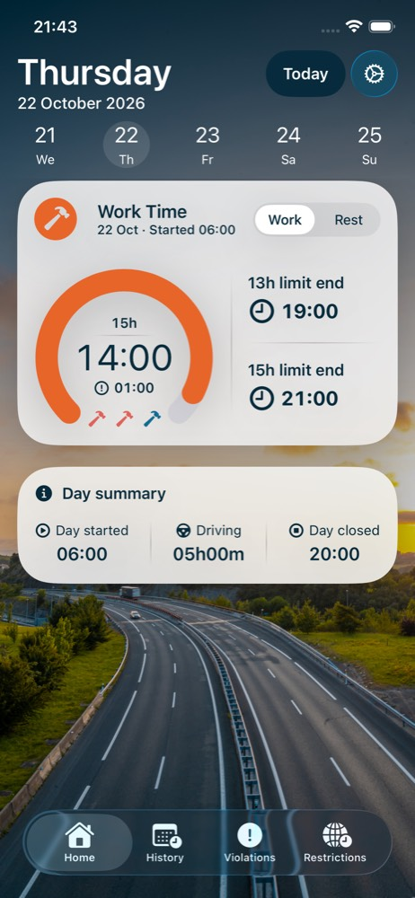 |
| Past day (2 days ago), Rest Taken, 2 used | 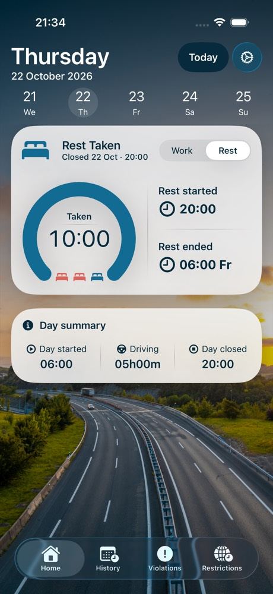 | 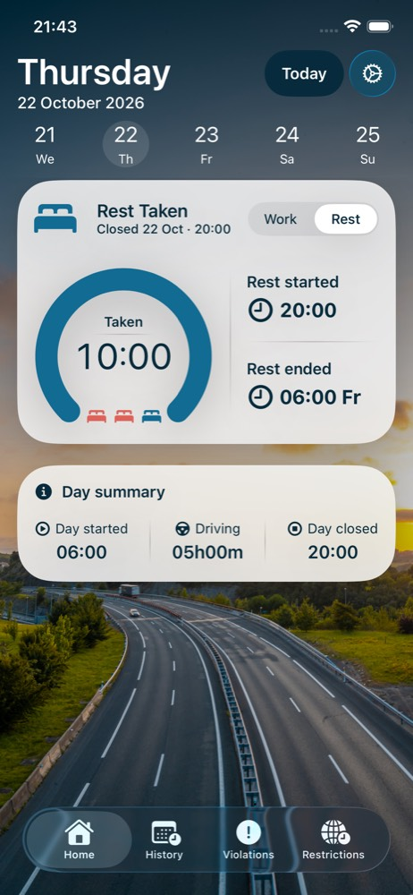 |
| Unknown count, Rest: three blue beds | 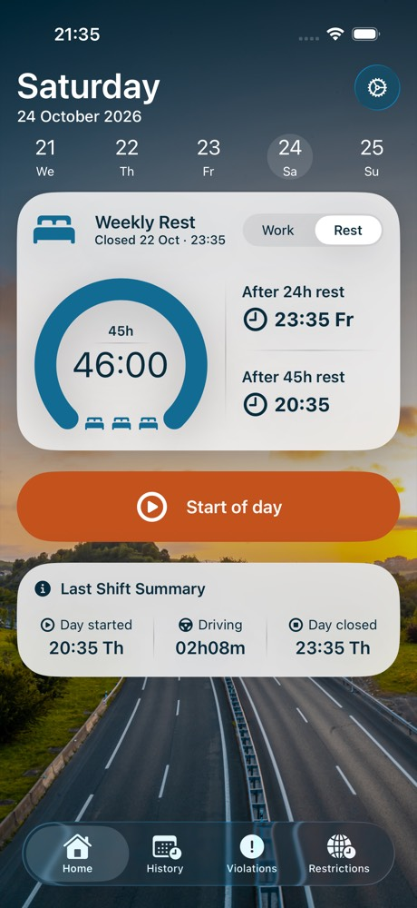 | 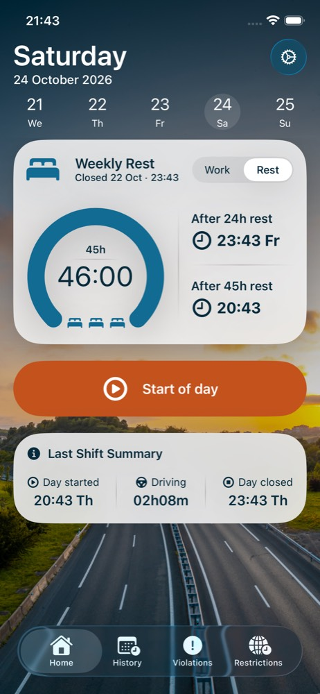 |
| Unknown count, Work: three blue hammers | 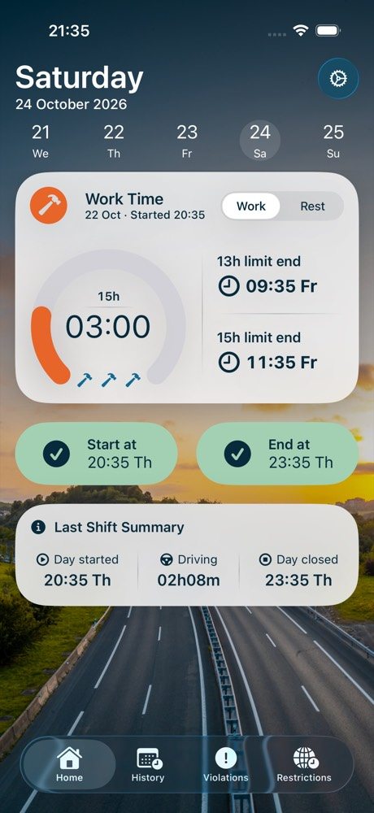 | 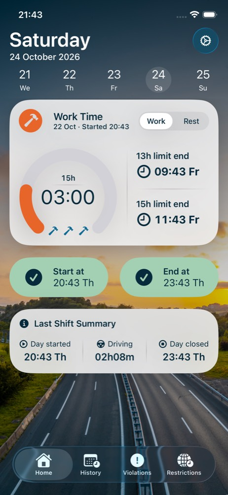 |

The hammers are 18 × 18 pt as in Figma 564:39337 (the task text said 18 × 20; Figma wins), bottom-aligned with the beds' baseline, 8 pt apart (26 pt step), row 70 pt wide and centred under the gauge. The accessibility element keeps the bed row's 70 × 20 frame: at 18 pt the audit flagged its hit area.

## Debug launch arguments

`-homeFlowUITest -resetHomeFlowTest -seedCountHistory` seeds a weekly rest ending three days ago 08:00, a 12 h shift with a 10 h rest, a 14 h shift with a 10 h rest, and yesterday's 10 h shift with its rest still running. End of day: three days ago 0, two days ago 2, yesterday and today 2. Add `-startDaysBack N` to open that day. The PR #11 arguments (`-seedReducedRests`, …) are unchanged.
