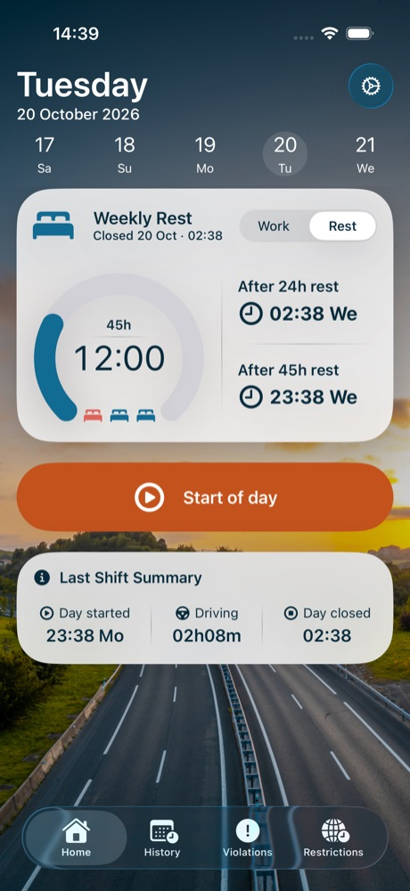
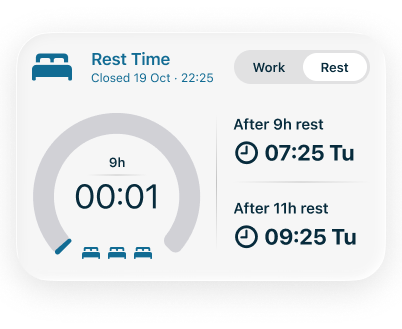
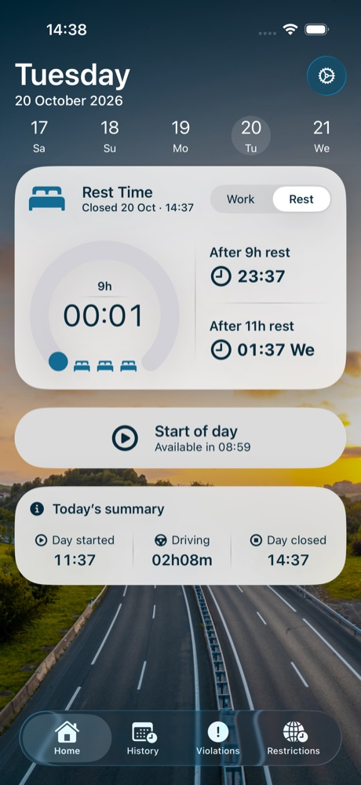
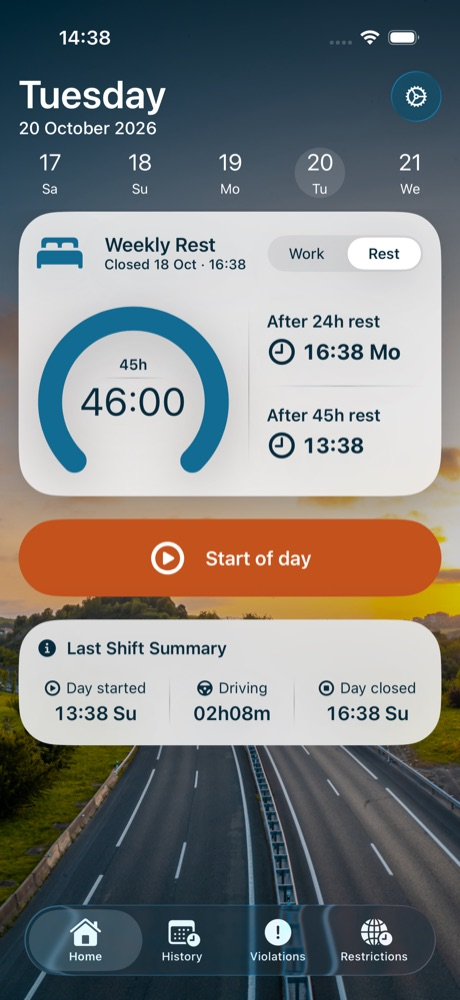

# Reduced daily rest counter (0–3)

Task: [TachoBook — Reduced Daily Rest Counter (0–3)](https://app.notion.com/p/3fedb41bd74b8136abc8ce9824dc72ff)
Executor: Claude Code. Branch: `claude/reduced-rest-counter`. Base: `a0a3aba1a54f045a2c8a495d4e02efb80814bd83` (origin/main).
Figma: [Main widget — Weekly Rest, 490:26367](https://www.figma.com/design/rpZZnwAC53fG7zjQy42Snq/TachoBook--UI-Design?node-id=490-26367) and [Main widget — Rest Time, 490:26319](https://www.figma.com/design/rpZZnwAC53fG7zjQy42Snq/TachoBook--UI-Design?node-id=490-26319). Figma values are sample content.

## What the driver gets

- Three beds under the rest gauge, in the daily (Rest Time) and the weekly (Weekly Rest) card. Red beds, on the left, are reduced daily rests used since the last weekly rest; blue beds are still available.
- The beds are hidden while the count is unknown: the saved records contain no completed rest of 24 h or more. They appear once the records allow a correct count. The beds have no tap action.
- VoiceOver reads the row as one element, for example "2 of 3 reduced rests used" ("4 reduced rests used, limit 3" after a fourth reduction).

## Rules as built (Regulatory Rules Specification v1)

| Topic | Behaviour |
|---|---|
| Rest after a shift | From Day closed of a shift to Day started of the next record (the same "rest taken" as in Day history). The rest after the latest record is still running and is never counted (V12). |
| 24 h window (R-D01) | A = Day started of the shift (the end of the previous rest). D = A + 24 h, in elapsed seconds. |
| Classification (R-D02, R-W01) | Total ≥ 24 h: weekly boundary. Otherwise the part inside A…D: ≥ 11 h regular; 9 h up to less than 11 h reduced; less than 9 h shortfall (not a reduction, V04). All thresholds inclusive. |
| Split 3+9 (R-D03) | A pause (Close → Resume) of at least 3 h inside the window, marked as confirmed rest, followed by a final rest with ≥ 9 h inside the window: regular split, not counted (V06). A pause not marked as confirmed never makes a split (V08). |
| Count (R-D04) | Reduced rests since the latest completed rest ≥ 24 h. Each counts once, when it ends. Calendar weeks play no part (V36). Not capped at 3. |
| Unknown (R-U01, P2) | No completed rest ≥ 24 h in the records, or a record after it without Day started or Day closed: unknown, never 0. Records with no times (only driving) are ignored. |
| 13 / 15 h (R-D05) | `DayLogModel.dutyLimitAvailability`: 15 h when the count is 0–2 or a confirmed split-first pause ≥ 3 h exists; 13 h only at count ≥ 3 without a split; unknown otherwise (also with count ≥ 3 and an unconfirmed long pause). Exposed for the Work card markers and the Resume flow; the marker visuals are unchanged. |
| Edits (R-E01) | The count is derived from the saved records on every read, so any history edit and any relaunch recompute it. |

## Screenshots (iPhone 17 Pro, 402 pt; and 390 pt)

| Figma | App |
|---|---|
|  |  |
|  |  |
| — (count unknown) |  |

390 pt: `weekly-1-used-390.jpg`, `daily-0-used-390.jpg`, `hidden-unknown-390.jpg`.

## Debug launch arguments (UI tests and screenshots)

`-homeFlowUITest -resetHomeFlowTest -seedReducedRests N` seeds a completed 46 h weekly rest, N reduced rests (12 h duty, 10 h rest) and a current daily rest of 1 min; add `-seedWeeklyCard` for a rest of 12 h (weekly card).
