# Country at shift start and close

Task: [P-003 — Країна при відкритті й закритті зміни](https://app.notion.com/p/3f8db41bd74b81339773ee763eb0be6e)
Executor: Claude Code. Branch: `claude/shift-country`. Base: `7144229d56f26ebe550713886cdedbb6e444a0eb` (origin/main),
later merged with `c186fc7dd1698481544eaac493e79319e13efb7c` (origin/main).
Figma: [Flow - Country selection, node 779:10468](https://www.figma.com/design/rpZZnwAC53fG7zjQy42Snq/TachoBook--UI-Design?node-id=779-10468).

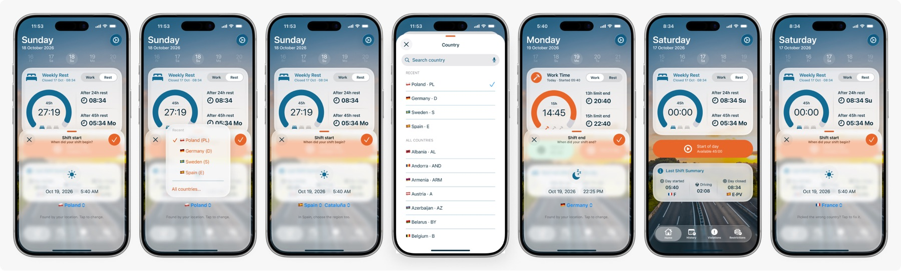

## Frames: 390 pt (iPhone 17e, iOS 27.2) and 402 pt (earlier session, 402 pt iPhone simulator)

All frames come from `CountryUITests` with a stubbed location (`-stubCountry`), so the system location prompt never
appears. Figma values are sample content; the app shows the current time.

The 390 pt set is the current one. The 402 pt set was taken before the summary columns were top-aligned
(13.11.2026, see below), so in `402-6-summary.jpg` "Driving" still sits lower than the other two columns.

| # | 390 pt | 402 pt |
|---|---|---|
| 1 start sheet, Poland found by location |  |  |
| 2 country menu: recent + All countries… | 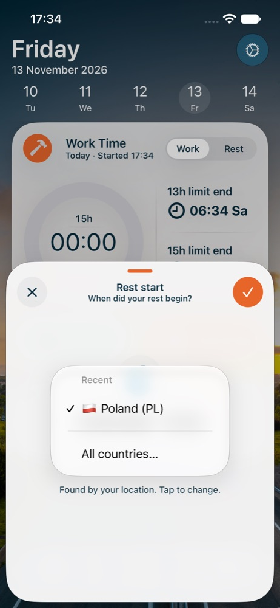 | 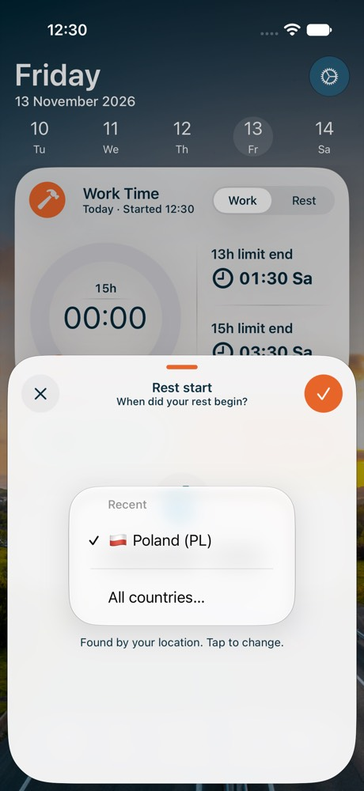 |
| 3 Spain with region | 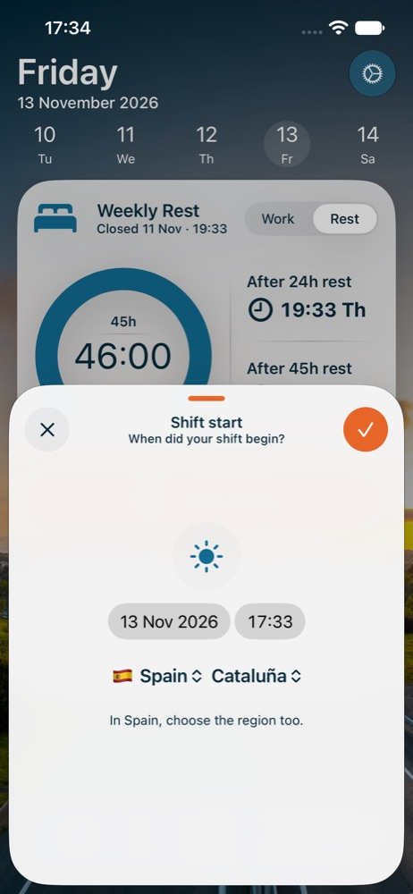 | 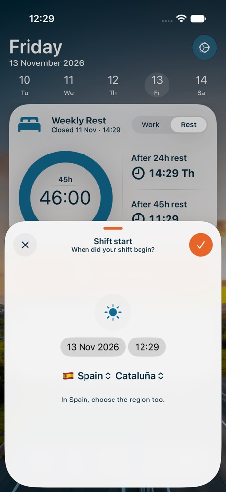 |
| 4 all countries with search | 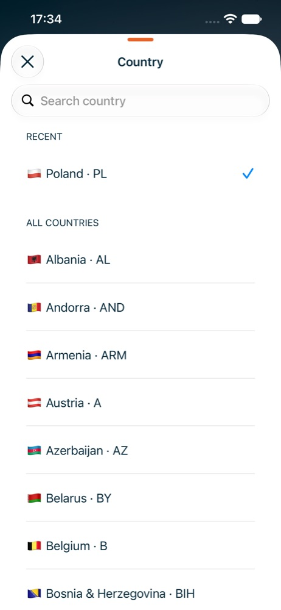 | 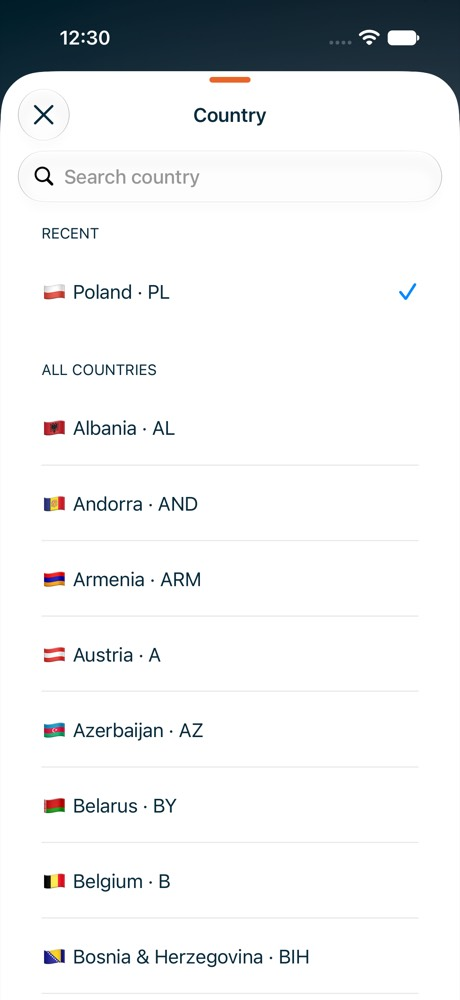 |
| 5 close sheet, Germany picked | 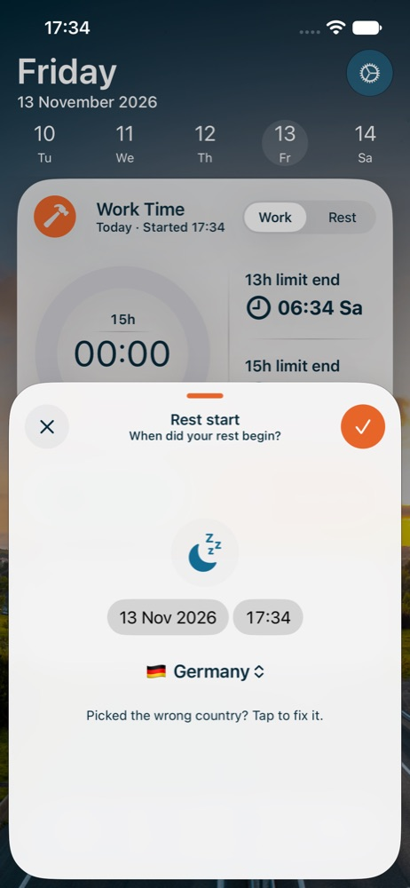 | 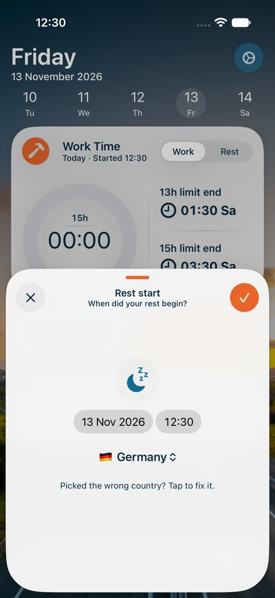 |
| 6 summary with countries | 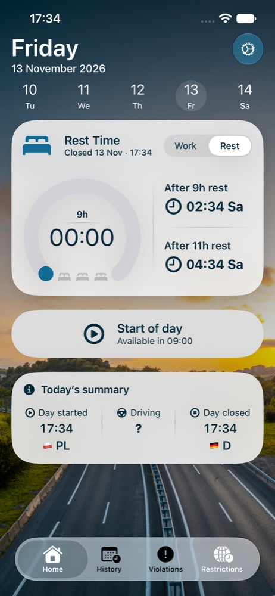 | 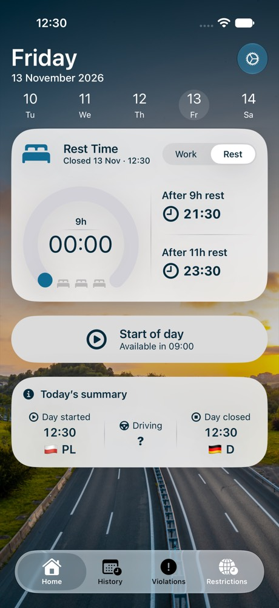 |
| 7 edit start of an old shift | 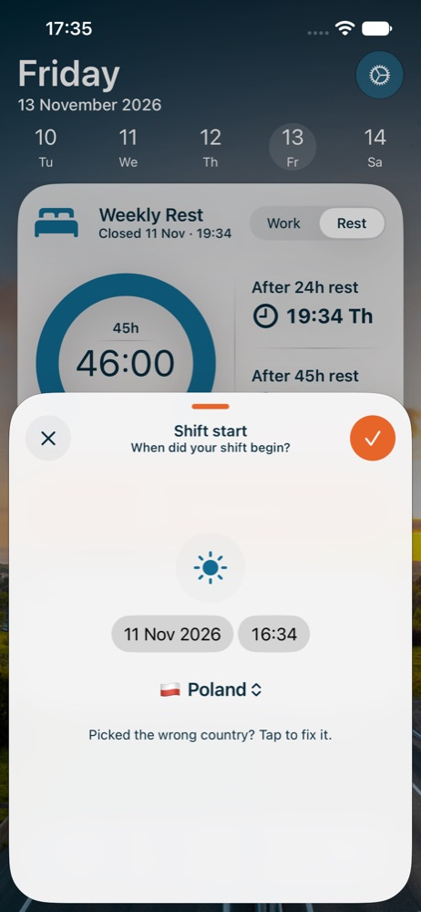 | 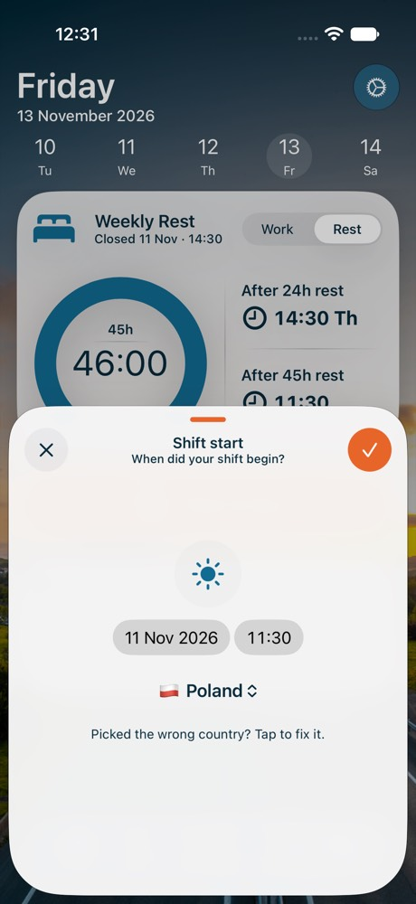 |
| 8 no location: last country offered | 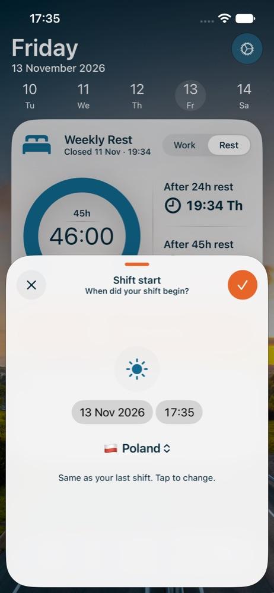 | 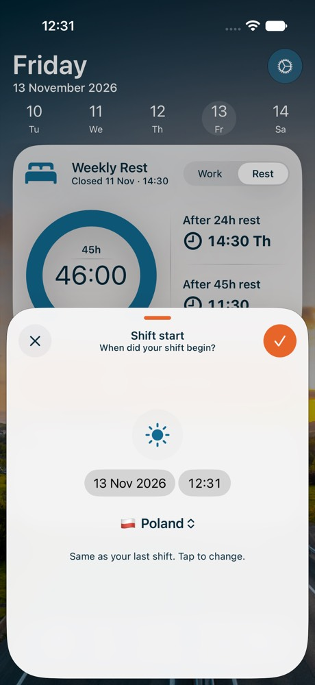 |
| 9 no location, no history: must choose | 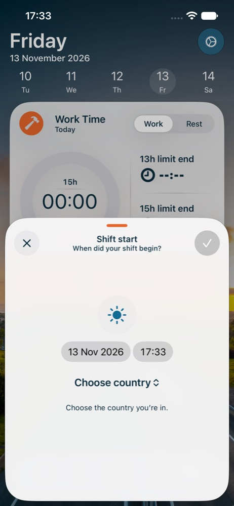 | 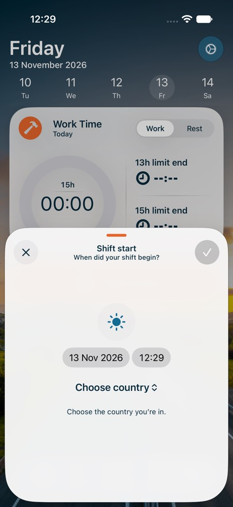 |

## Differences from Figma

- **Summary columns are top-aligned** (Serhii, 13.11.2026). In Figma "Driving" is centred, so it sits half a line
  lower than "Day started" / "Day closed", which now have a country line. Centred, it failed the accessibility
  contrast audit on iOS 27.2 in three Home audits; top-aligned, all pass.
- **Country popup text is #072B3C**, not the accent blue of the Figma Popup Button: project rule, text only
  #072B3C or white.
